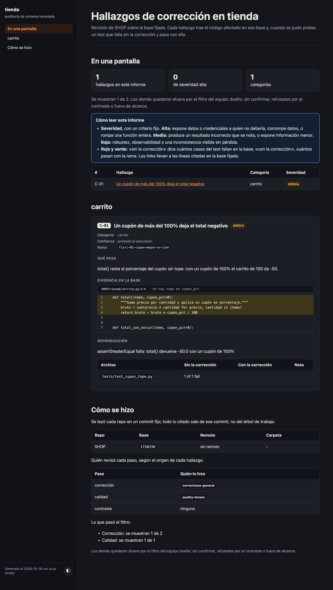

# inherited-audit

Una skill para Claude Code y Cursor, con un CLI (`ia.py`), para auditar un sistema que heredaste antes de construir encima:
uno o varios repos (back, front, workers, CLIs o librerías) en TypeScript/JavaScript, Python, Java o Kotlin (con
Spring o sin él), Go u otro stack. Dirige la auditoría de punta a punta y entrega dos reportes HTML autocontenidos para el equipo dueño:
uno de **correctitud** (bugs, condiciones de carrera, fallas de sistemas distribuidos, seguridad, cada hallazgo de
código probado con un test que falla en la base) y uno de **calidad y arquitectura** (cada hallazgo con una sugerencia
y, si es un número, con la medición de una herramienta). En el camino suma los tests unitarios y e2e que faltan, en una
rama aparte.

| Le decís al agente… | Y la skill… |
|---|---|
| *«Auditá este sistema antes de que empecemos: el back está en ~/w/api y el front en ~/w/web»* | fija el commit de cada repo, mide la suite, pregunta una sola vez qué obreros faltan instalar y recorre el checklist hasta los dos reportes |
| *«Auditá este servicio de Spring Boot que heredamos: ~/w/pagos»* | detecta Maven o Gradle, corre la suite sin bajar dependencias (si falta la caché, pregunta antes de instalar), cuenta los tests desde los reportes JUnit y arma los módulos por paquete |
| *«Retomá la auditoría de tienda»* | lee `manifest.json` de la corrida y sigue en el primer paso que no está hecho, en Claude Code o en Cursor |
| *«¿Qué quedó afuera del reporte y por qué?»* | corre el filtro y te dice cuántos hallazgos se muestran de cuántos, y qué regla dejó afuera al resto |

**La skill nunca hace push, ni abre PRs, ni crea issues, ni instala nada sin preguntarte.** Las ramas con los tests
quedan locales y los reportes se escriben fuera de los repos auditados, donde git no los puede commitear.

## Elegí por dónde empezar

| Componente | Qué resuelve | Escribe | Se instala con | Showcase | Instalación |
|---|---|---|---|---|---|
| **`inherited-audit`** (la skill) | El checklist, el orden, los criterios de aceptación y a quién le toca cada paso en cada host | La corrida (fuera de los repos) y una rama local por hallazgo | `./install.sh` | [Ver el caso](docs/showcase.md#1-arrancar-una-auditoría) | [Instalar](docs/instalacion.md#1-instalar) |
| **`ia.py`** (el CLI) | Lo mecánico: fijar la base, guardar hallazgos, revisar citas, ramas e higiene, filtrar y armar los HTML | `manifest.json`, `findings/`, `outputs/` y los reportes de la corrida | `./install.sh` | [Ver el caso](docs/showcase.md#2-probar-un-hallazgo-con-un-test-que-falla) | [Instalar](docs/instalacion.md#2-auditar-desde-claude-code) |
| **Los reportes** | Dos HTML autocontenidos para el equipo dueño, con el tema en un CSS que se puede cambiar | `<sistema>-correctness.html` y `<sistema>-quality.html` | `./install.sh` | [Ver el caso](docs/showcase.md#4-los-dos-reportes) | [Instalar](docs/instalacion.md#3-auditar-desde-cursor) |
| **`ia-auditor`** (subagente opcional) | Una definición de subagente por host que lee una pasada y la sigue | Nada propio: lo que diga la pasada | `./install.sh --agents` | [Ver el caso](docs/showcase.md#6-los-subagentes-opcionales) | [Instalar](docs/instalacion.md#5-sumar-los-subagentes-opcionales) |

## Un ejemplo: el reporte de correctitud de un repo de prueba

Una corrida sobre `tienda`, un repo de juguete con un bug a propósito: un cupón de más del 100% deja el total negativo.
El hallazgo trae el código citado en el commit fijado, la rama con el test en rojo (cuántos casos fallan) y la propuesta escrita de corrección. El
recorrido entero está en el [showcase](docs/showcase.md#4-los-dos-reportes).



*Salida real de `ia.py render` sobre el repo de prueba.*

## Qué documento leer

| Si querés… | Leé | Qué encontrás |
|---|---|---|
| **Instalarla y probarla, conversando con tu agente** | [Instalación y primer uso](docs/instalacion.md) | Todo con prompts, en Claude Code y en Cursor: instalar, auditar, retomar |
| **Instalarla comando por comando** | [Instalación detallada](docs/instalacion-detallada.md) | Requisitos, `./install.sh`, cada comando de `ia.py` y sus códigos de salida, con capturas |
| **Ver todo lo que hace** | [Showcase](docs/showcase.md) | Cada caso: qué le decís al agente, qué corre, qué ves y qué pasa si algo falla |
| **Consultar el checklist y los formatos** | [Referencia](docs/referencia.md) | Los once pasos, los obreros por host, las opciones, la carpeta de una corrida, los campos de un hallazgo y los códigos de salida |

## En tres comandos

```bash
cd <ruta-a-tu-clon>/inherited-audit && ./install.sh   # enlaza skill/ en ~/.claude/skills
python3 ~/.claude/skills/inherited-audit/ia.py --help
python3 ~/.claude/skills/inherited-audit/ia.py status --run <carpeta-de-la-corrida>
```

El estado de la corrida no se edita a mano: el plan de cada repo cambia con `ia.py baseline --set` y el resto del
manifest (`host`, `sections`, `strengths`, la rama de tests) con `ia.py set --run <carpeta-de-la-corrida> CLAVE=VALOR`.

Requisitos: `python3` 3.9 o más (solo biblioteca estándar) y `git` 2.38 o más. Los obreros externos (semgrep,
osv-scanner, los plugins de cada host) son opcionales: la skill pregunta por ellos una vez.

## Desarrollo

```bash
python3 -m unittest discover -s tests
/usr/bin/python3 -m unittest discover -s tests   # compatibilidad con 3.9
hdoc check .   # opcional: si tenés harness-docs, revisa el formato de esta documentación
```

TDD y Conventional Commits. Solo `skill/` se instala: `tests/` y `docs/` quedan en el repo. La tabla de referencia de
un sistema con hallazgos conocidos, contra la que `ia.py eval` mide cuántos redescubre una corrida, vive fuera del
repo compartido, para que nadie vea las respuestas. Se usa con `ia.py eval --run <corrida> --reference
<ruta>/<tabla-de-referencia>.json`, y el test que la lee corre con
`IA_EVAL_REFERENCE=<ruta>/<tabla-de-referencia>.json python3 -m unittest discover -s tests` (sin la variable se
omite). Los tests que corren Maven y Gradle de verdad, en Docker, contra un proyecto Spring Boot en Java y otro en
Kotlin, corren con `IA_DOCKER_JVM=1 python3 -m unittest discover -s tests -p test_jvm_docker.py` (bajan las imágenes
`maven` y `gradle` y las dependencias a volúmenes de Docker que borran al terminar; sin la variable se omiten). Lo
mismo con los nombres del sistema auditado que nunca tienen que aparecer en `skill/` ni en `agents/`: viven
en un archivo aparte, una expresión regular por línea, y el test los suma con `IA_LEAK_TERMS=<ruta>`. Las capturas se
rehacen con `docs/img/src/demo/setup.sh` (arma un `HOME` de prueba con el repo `tienda`) y `hdoc term` / `hdoc
render`.
