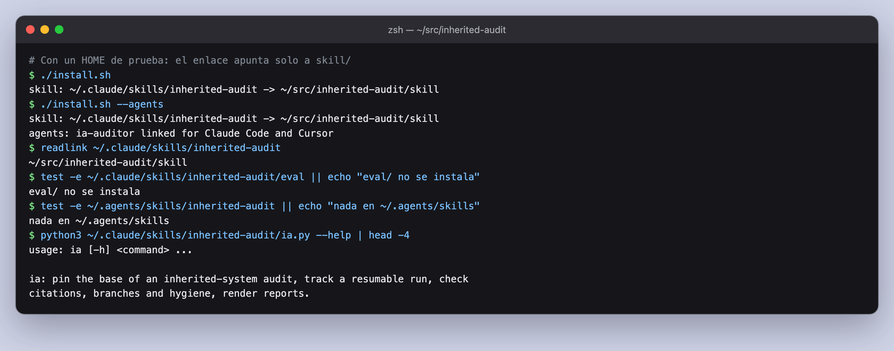
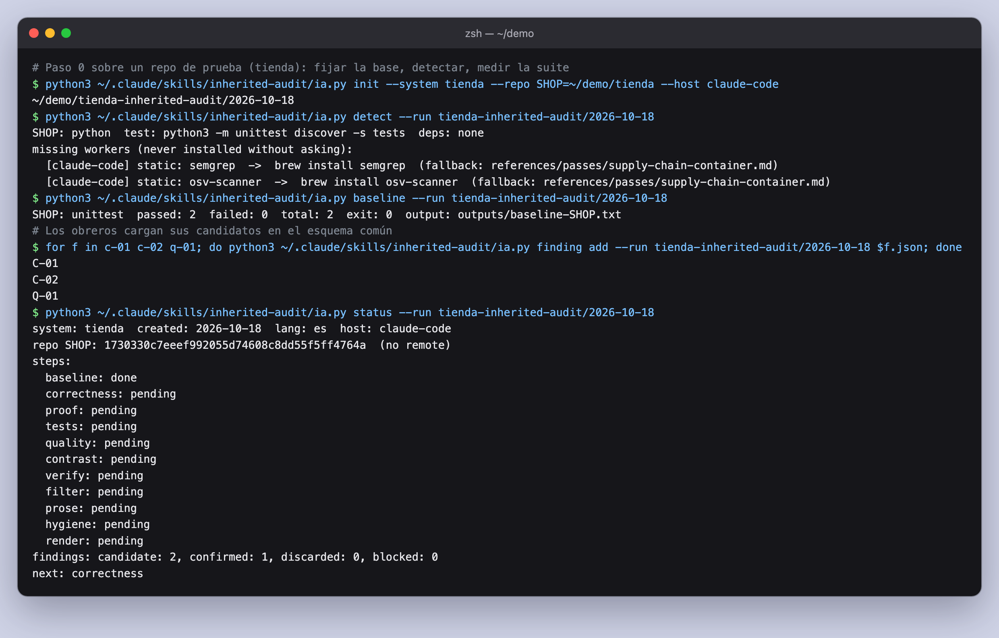
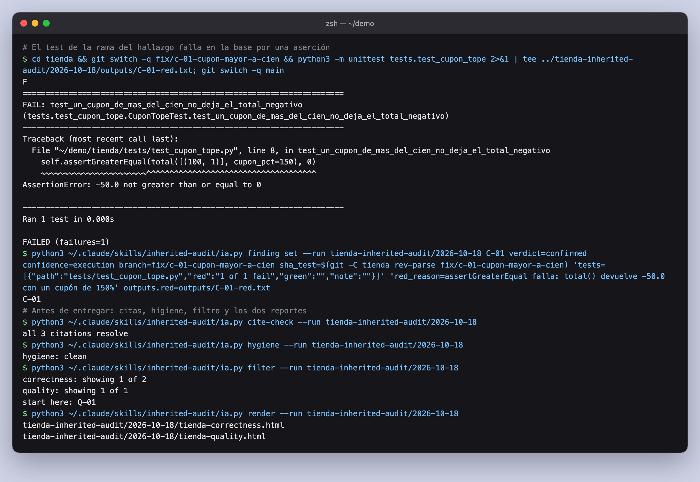
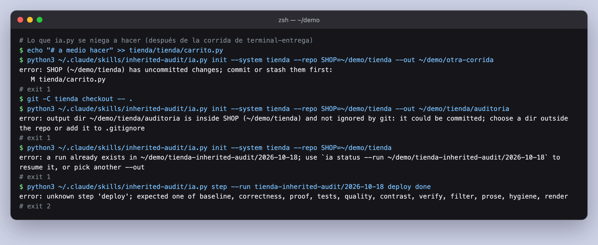

# Instalación detallada: comando por comando

Lo mismo que la [guía con prompts](instalacion.md), con los comandos y su salida. En el día a día los corre el agente;
acá están para que veas qué hace cada uno.

## 1. Requisitos

- `python3` 3.9 o más. `ia.py` usa solo la biblioteca estándar.
- `git` 2.38 o más (`merge-check` usa `git merge-tree --write-tree`).
- Claude Code, Cursor o los dos. Los obreros externos (semgrep, gitleaks, trivy, osv-scanner, los plugins de cada host)
  son opcionales; la tabla completa con sus comandos de instalación está en
  [`skill/references/workers.md`](../skill/references/workers.md).

## 2. Instalar

```bash
cd <ruta-a-tu-clon>/inherited-audit && ./install.sh
./install.sh --agents   # opcional: también los subagentes ia-auditor
```



| Enlace | Apunta a | Cuándo |
|---|---|---|
| `~/.claude/skills/inherited-audit` | `skill/` del repo | Siempre |
| `~/.claude/agents/ia-auditor.md` | `agents/claude/ia-auditor.md` | Con `--agents` |
| `~/.cursor/agents/ia-auditor.md` | `agents/cursor/ia-auditor.md` | Con `--agents` |

Solo se enlaza `skill/`, así que `tests/` y `docs/` no quedan al alcance del agente (la tabla de referencia de `eval` ni siquiera está en el repo: vive aparte, y se pasa con `--reference <ruta>`; el test que la lee usa `IA_EVAL_REFERENCE`). Volver a correrlo no rompe
nada; si en una de esas rutas hay un archivo o una carpeta de verdad, no lo reemplaza y sale con 1. `./install.sh -h`
muestra la ayuda y un argumento desconocido sale con 2.

**Un solo lugar para los dos hosts.** Cursor lee `~/.claude/skills` por compatibilidad
(cursor.com/docs/context/skills), así que el instalador no escribe en `~/.agents/skills`: con las dos rutas, Cursor
cargaría la skill dos veces.

**Pendiente de verificar:** que en una sesión de `cursor-agent` la skill aparezca listada exactamente una vez después de
`./install.sh`. Todavía no se midió; cuando se mida, va acá con la fecha y la versión de Cursor.

## 3. En qué host está corriendo

La skill le pasa el host a `ia.py init --host`, y con eso elige la fila de obreros. Medido el 2026-10-18 sobre el
entorno que cada host le da a los comandos:

| Variable | Quién la pone |
|---|---|
| `CURSOR_AGENT` (y `CURSOR_INVOKED_AS`) | El agente de Cursor. Puede heredar además `CLAUDECODE` de un proceso padre, por eso se mira primero |
| `CLAUDECODE=1` (y `CLAUDE_CODE_ENTRYPOINT`) | Claude Code |

Primero `CURSOR_AGENT`, después `CLAUDECODE`; si no está ninguna, el agente te pregunta y, si no sabés, usa `unknown`.

## 4. Paso 0: fijar la base y medir

Las capturas de esta guía y del showcase salen de `tienda`, un repo de juguete con un bug a propósito, armado por
[`img/src/demo/setup.sh`](img/src/demo/setup.sh) dentro de un `HOME` de prueba.



| Comando | Qué hace |
|---|---|
| `init --system <nombre> --repo ALIAS=RUTA[:SUBCARPETA] --host <host>` | Crea la corrida (por defecto `<carpeta que contiene la raíz git del primer repo>/<sistema>-inherited-audit/<fecha>/`) y fija el `HEAD` de cada repo. El nombre del sistema va en nombres de archivo: letras, números, `.`, `_` y `-`, empezando por letra o número. `--repo` se repite; el alias es con lo que empieza cada cita. Opcionales: `--publish`, `--lang`, `--out` |
| `detect --run <corrida>` | Stack, comando de tests y dependencias de cada repo, y los obreros que faltan en este host con su comando de instalación. Propone `deps: none` salvo que la carpeta de dependencias ya exista y coincida con el lockfile; la instalación queda como sugerencia y se pregunta. Lo que se baja con `npx` va aparte: siempre se pregunta |
| `baseline --run <corrida>` | Corre cada suite en el commit fijado, en un worktree descartable, y guarda la salida cruda en `outputs/`. Los números salen del comando de tests; la cobertura, de un paso aparte que si falla no los pierde |
| `finding add --run <corrida> <archivo.json>` | Valida un hallazgo contra el esquema y le asigna id (`C-NN` correctitud, `Q-NN` calidad) |
| `status --run <corrida>` | Cada paso con su estado y cuál sigue: así se retoma |
| `baseline --run <corrida> --set ALIAS CLAVE=VALOR…` | Corrige el plan de un repo sin correr nada (por ejemplo `test_cmd`, `env`, `deps=install` cuando aceptaste instalar). Un `detect` posterior respeta lo que cambiaste |
| `set --run <corrida> CLAVE=VALOR…` | Cambia claves del manifest sin editarlo a mano: `host`, `lang`, `options.publish`, `sections.correctness`, `sections.quality`, `strengths`, `baseline.<ALIAS>.tests_branch` y el resultado de la línea base a mano (`baseline.<ALIAS>.result.passed`, `failed`, `total`, `coverage`, `runner`, `measured`). Valida todo antes de guardar |

Lo que `detect` lista como faltante depende de la máquina donde corre: la captura muestra la de quien la armó.

## 5. Probar, revisar y entregar



| Comando | Qué hace |
|---|---|
| `finding set --run <corrida> <id> CLAVE=VALOR…` | Cambia campos (claves con punto, valores JSON). Un hallazgo de código confirmado por ejecución sin `tests` ni `red_reason` se rechaza |
| `merge-check --run <corrida>` | Prueba de a pares que las ramas de los hallazgos combinen sin conflictos |
| `cite-check --run <corrida>` | Cada cita tiene que existir en el commit fijado, con sus líneas |
| `hygiene --run <corrida>` | Secretos e ids de 40 caracteres en ramas y salidas, archivos de herramientas locales en los commits, corrida commiteable |
| `filter --run <corrida>` | Decide qué ve el equipo dueño e informa cuántos se muestran de cuántos |
| `render --run <corrida>` | Escribe los dos HTML en la corrida. No corre antes de `filter`. `--theme otro.css` cambia el aspecto |
| `publish --run <corrida>` | Solo con `publish` encendido y después de `filter`: escribe cuerpos de issues y PRs y `publish/commands.sh`, listo para correr tal cual una vez revisado (`set -eu`, rutas absolutas, `--repo` en cada `gh`, primero los issues y después los PRs en borrador que los referencian con `Refs #N.` sin cerrarlos, porque la rama solo trae el test que falla; el push comentado). Nunca lo corre |
| `eval --run <corrida> --reference <tabla.json>` | Mide cuántos hallazgos conocidos de un sistema de referencia redescubre una corrida; la tabla vive fuera del repo |

## 6. Lo que se niega a hacer



| Código | Cuándo |
|---|---|
| 0 | Salió bien |
| 1 | El comando encontró problemas: repo con cambios, salida commiteable, corrida existente, cita rota, ramas que no combinan, higiene sucia, hallazgo inválido |
| 2 | Uso: un paso, un estado o un argumento que no existe |
| 3 | Una herramienta externa falló o no está (por ejemplo `git`) |

## De dónde sale cada captura

| Imagen | Origen |
|---|---|
| `terminal-instalar.png` | Salida **real** de `./install.sh` con un `HOME` de prueba y el repo en `~/src/inherited-audit`, el 2026-10-19; rutas acortadas a `~` |
| `terminal-corrida.png` | Salida **real** de `ia.py` sobre el repo de prueba `tienda`, con un `HOME` de prueba, el 2026-10-18 |
| `terminal-entrega.png` | Salida **real**, la misma corrida, a continuación |
| `terminal-rechazos.png` | Salida **real**, la misma corrida, después de `terminal-entrega` |

Las fuentes están en [`img/src/`](img/src/): un `.txt` por captura, el `.html` que arma `hdoc term` y, en `demo/`, el
guion que arma el repo de prueba y los tres hallazgos que se cargan.
