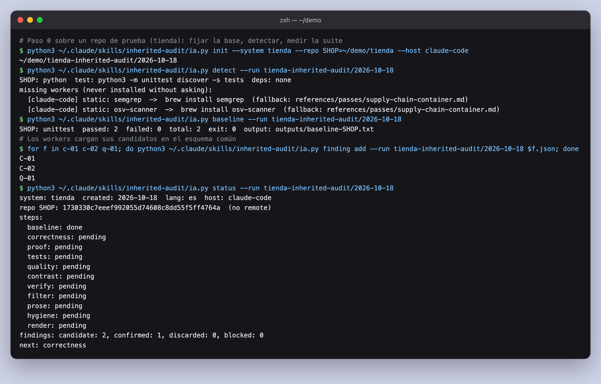
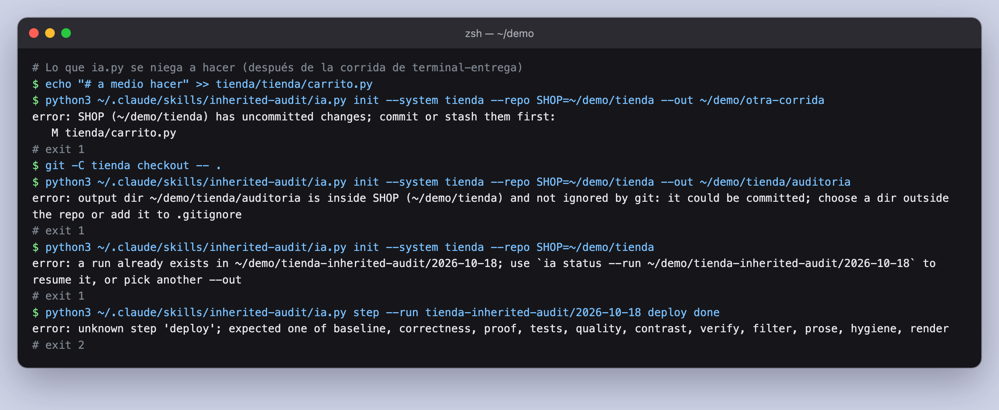
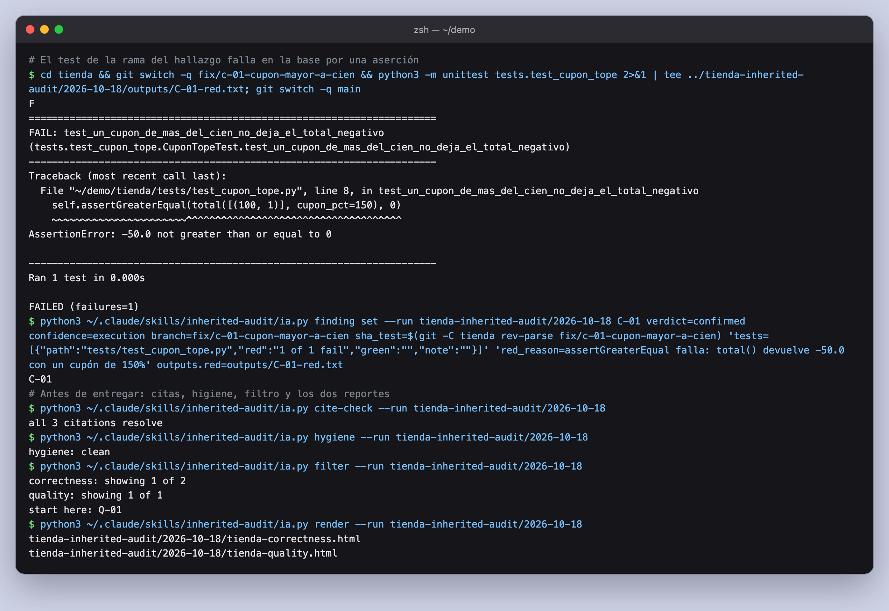
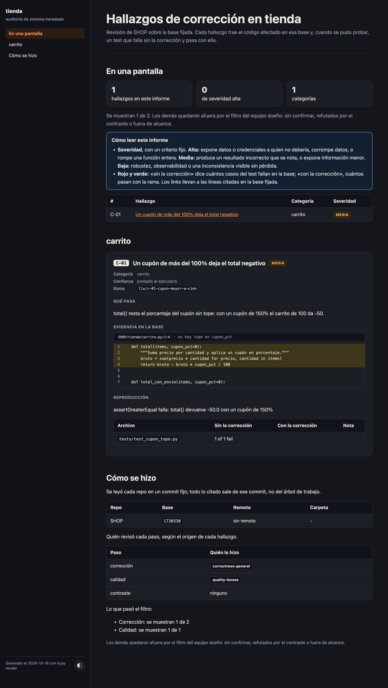

# Showcase

Qué se puede hacer con `inherited-audit`, caso por caso. Para instalarla, la [guía con prompts](instalacion.md) o la
[detallada](instalacion-detallada.md); cada paso con su criterio de aceptación, en las
[instrucciones de la skill](../skill/SKILL.md).

Las capturas salen de `tienda`, un repo de juguete con un bug a propósito: `total()` aplica un cupón en porcentaje sin
tope, así que con un cupón de 150% un carrito de 100 da -50.

| Componente | Escenario | Ir al caso |
|---|---|---|
| `inherited-audit` | «Auditá este sistema antes de que empecemos» | [Arrancar una auditoría](#1-arrancar-una-auditoría) |
| `ia.py` | «Probá que ese bug existe» | [Probar un hallazgo](#2-probar-un-hallazgo-con-un-test-que-falla) |
| `ia.py` | «¿Está todo listo para entregar?» | [Antes de entregar](#3-antes-de-entregar) |
| Los reportes | «Armá los reportes para el equipo dueño» | [Los dos reportes](#4-los-dos-reportes) |
| `inherited-audit` | «Retomá la auditoría» | [Retomar en otro host](#5-retomar-en-otro-host) |
| `ia-auditor` | «Usá un subagente con nombre» | [Los subagentes opcionales](#6-los-subagentes-opcionales) |
| `inherited-fix` | «Arreglá el hallazgo C-24» | [Arreglar un hallazgo publicado](#7-arreglar-un-hallazgo-publicado) |

---

## Lo que lo distingue

| | |
|---|---|
| **Dirige la obra, no la construye** | La skill tiene el checklist, el orden y los criterios de aceptación. El trabajo lo hacen las skills del host o externas; donde no hay nada bueno (por ejemplo, condiciones de carrera y sistemas distribuidos), trae su propia pasada |
| **Rojo por la razón correcta** | Cada hallazgo de código tiene una rama local con un commit de solo tests que falla una aserción en el commit fijado. Un import roto o un error de setup no cuenta |
| **Igual en Claude Code y en Cursor** | Una sola carpeta instalada sirve para los dos; cada paso tiene su worker en cada host y la corrida se retoma en cualquiera |
| **Se puede retomar** | Todo el estado vive en la carpeta de la corrida (`manifest.json` y un archivo por hallazgo), fuera de los repos auditados |
| **Pensado para el equipo dueño** | Filtro con regla explícita, «se muestran N de M», prosa sin jerga ni culpas, y una segunda mirada de otro modelo antes del filtro |

---

## 1. Arrancar una auditoría

**Componente:** `inherited-audit` + `ia.py` · **Escribe:** la carpeta de la corrida, al lado del primer repo.

Le decís *«Auditá el sistema tienda: el código está en ~/demo/tienda»*. El agente detecta el host, crea la corrida,
fija el commit, mide la suite y te pregunta una sola vez por los workers que faltan.

*Salida real sobre el repo de prueba.*

| Situación | Resultado |
|---|---|
| Un repo tiene cambios sin commitear | `init` sale con 1 y lista los archivos: el commit fijado tiene que coincidir con lo que se lee |
| La carpeta de salida queda dentro de un repo y git la podría commitear | `init` sale con 1: los reportes llevan hallazgos de seguridad |
| Ya hay una corrida en esa carpeta | `init` sale con 1 y te dice cómo retomarla |
| Falta un worker | Se pregunta una vez, con el comando exacto; si no lo instalás, lo cubre una pasada propia toda la corrida |

*Salida real, la misma corrida.*

## 2. Probar un hallazgo con un test que falla

**Componente:** `ia.py` (`finding add`, `finding set`, `merge-check`) · **Escribe:** una rama local por hallazgo, sin
upstream, en el repo auditado.

Cada worker carga sus candidatos en un esquema común. Después, un subagente por candidato, en su propio worktree, crea
la rama con un commit de solo tests. En `tienda`, el test falla porque `total()` devuelve -50.0: es una aserción sobre
el código de la base, no un error de setup.

*Salida real, la misma corrida.*

| Situación | Resultado |
|---|---|
| El rojo no se reproduce con una aserción, o el arreglo necesita un refactor | El candidato se descarta con el motivo; es un resultado válido |
| Se confirma un hallazgo de código sin `tests` ni `red_reason` | `finding set` lo rechaza y sale con 1 |
| Configuración, CI, contenedor o cadena de suministro | No llevan rama: se confirman con el comando que se corrió y su salida guardada, o con documentación |
| El hallazgo se confirma | La rama termina en el test rojo (un solo commit, solo tests) y el arreglo queda como propuesta escrita en `fix_summary`; la skill nunca lo aplica |

## 3. Antes de entregar

**Componente:** `ia.py` (`cite-check`, `hygiene`, `filter`) · **Escribe:** solo en la corrida.

En la captura de arriba: las tres citas resuelven en el commit fijado, la higiene da limpio y el filtro muestra 1 de
los 2 hallazgos de correctitud (el otro quedó sin verificar) y 1 de 1 de calidad.

| Revisión | Qué mira |
|---|---|
| `cite-check` | Que cada `ALIAS/ruta` y sus líneas existan en el commit fijado; nombra el hallazgo, la cita y el motivo |
| `hygiene` | Secretos e ids de 40 caracteres en ramas y salidas guardadas, archivos de herramientas locales en los commits, corrida commiteable |
| `filter` | En correctitud, solo lo confirmado y sin exclusiones (refactor, funcionalidad nueva, herramientas, dudoso, sin código). En calidad, lo que no se descartó ni refutó el contraste. Nada `unverified` entra |

Antes del filtro corren el **contraste** (otro modelo, de otra familia si hay, revisa cada hallazgo en solo lectura) y
la **verificación** de todo lo de severidad alta por un subagente nuevo que no vio el razonamiento de quien lo encontró.

## 4. Los dos reportes

**Componente:** `ia.py render` · **Escribe:** `<sistema>-correctness.html` y `<sistema>-quality.html` en la corrida.

*Salida real de `ia.py render` sobre el repo de prueba.*

El HTML sale solo de los datos de la corrida y de git: el código citado viene de `git show` en el commit fijado, y la
propuesta de corrección sale escrita, sin diff. Si el repo tiene remoto, las citas son links; si no, texto. Cada
reporte es un solo archivo con el CSS y el JS adentro; para cambiar el aspecto, `--theme otro.css`, sin tocar el generador. Con
`publish` encendido, `ia.py publish` deja escritos los cuerpos de issues y PRs y los comandos `gh`: los corrés vos, o no.

## 5. Retomar en otro host

**Componente:** `inherited-audit` · **Escribe:** nada nuevo hasta seguir con el paso pendiente.

Le decís *«Retomá la auditoría de tienda»*, en Claude Code o en Cursor. El agente corre `ia.py status`, sigue en el
primer paso que no está hecho y lee del manifest las opciones que elegiste, sin volver a preguntarlas. Para saber en
qué host está mira primero `CURSOR_AGENT` y después `CLAUDECODE` (medido el 2026-10-18: el agente de Cursor puede
heredar `CLAUDECODE` de un proceso padre). Si cambió el host, lo anota con `ia.py set host=…`, vuelve a correr
`ia.py detect` (que respeta lo que corregiste del plan) y desde ahí usa los workers del nuevo.

| Situación | Resultado |
|---|---|
| La corrida la escribió una versión más nueva de `ia.py` | Se niega a seguir con un mensaje claro, en vez de perder campos en silencio |
| No hay `manifest.json` en la carpeta | Sale con 1: no es una corrida |

## 6. Los subagentes opcionales

**Componente:** `ia-auditor` · **Escribe:** lo que diga la pasada que le tocó.

La skill no depende de subagentes con nombre: lanza uno genérico con la ruta de la pasada, la corrida y el modelo. Si
preferís uno con nombre, `./install.sh --agents` enlaza `ia-auditor` para Claude Code y para Cursor. El de Cursor es de
solo lectura y sirve para las pasadas de análisis; las que escriben (el test rojo, los unitarios, el e2e) necesitan un
agente normal en su propio worktree.

---

## 7. Arreglar un hallazgo publicado

**Componente:** `inherited-fix` · **Escribe:** un worktree y `fix/commands.sh` en la corrida, y commits locales en la
rama del PR.

La auditoría se detiene en el test rojo a propósito: tocar el código de producción de otro equipo es decisión de ese
equipo. Cuando acepta los arreglos, la skill compañera `inherited-fix` toma la rama roja ya publicada (o el PR
borrador) y le suma el arreglo:

1. `ia.py fix plan` lista las ramas de PR para arreglar. Un PR de grupo se arregla entero, en orden, en un solo
   worktree.
2. `ia.py fix start` crea el worktree y corre la suite sobre un merge descartable con la base real del PR. Si el test ya
   pasa ahí, el hallazgo queda `moot`: alguien lo arregló antes.
3. Un subagente escribe el arreglo y `ia.py fix check` revisa que el test rojo siga intacto, el alcance y los mensajes,
   y que la suite no tenga fallas nuevas.
4. Otro agente, con un modelo que no juzgó antes ese hallazgo, revisa el commit; `ia.py fix done` lo registra solo con esa revisión.
5. `ia.py fix publish` deja en `fix/commands.sh` el push, el cuerpo del PR reescrito (`Refs` pasa a `Closes`) y
   `gh pr ready`. No lo corre: lo revisás y lo corrés vos.

Sin `fix.authorized_by` en el manifest (quién aceptó los arreglos, y cómo), `fix start` se niega. El detalle de cada
acción está en la [referencia](referencia.md#después-de-la-auditoría-arreglos-inherited-fix).

---

## Qué te protege y qué no

| Te protege | No te protege |
|---|---|
| Nunca hace push, ni PRs, ni issues; `publish` solo deja los comandos escritos | Las ramas locales y los reportes quedan en tu máquina: dónde los compartís lo decidís vos |
| `init` y `hygiene` se niegan a dejar la corrida donde git la pueda commitear | Si copiás un reporte a mano adentro de un repo, nada lo impide |
| `cite-check` confirma que cada cita existe en el commit fijado | Que la cita exista no prueba que el hallazgo sea cierto: eso lo hacen el test rojo, el contraste y la verificación |
| `hygiene` busca secretos e ids de 40 caracteres en ramas y salidas guardadas | Es una búsqueda por patrones: un secreto con un formato desconocido puede pasar |
| Lo `unverified` no entra en los reportes | El filtro aplica una regla; no juzga si un hallazgo confirmado es importante para tu equipo |
| La tabla de referencia de un sistema con hallazgos conocidos vive fuera del repo y no se instala | `eval` mide redescubrimiento contra esa tabla, no la calidad de un reporte sobre otro sistema |
